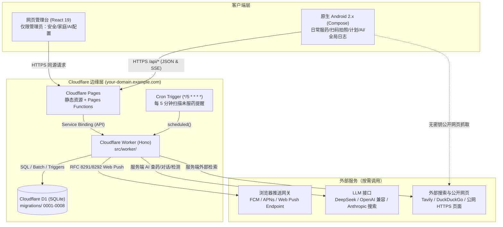
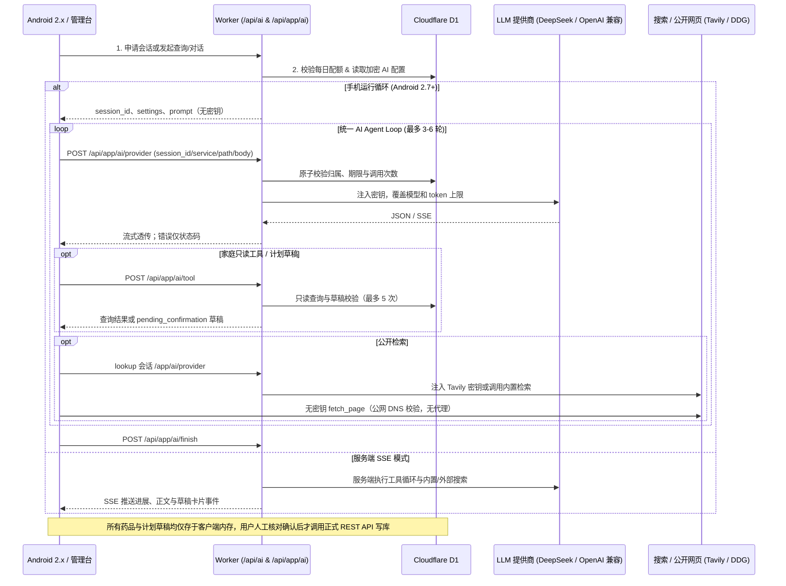

# 赛博药箱（HomeMeds）系统架构与设计手册

本文档详细说明**赛博药箱**的整体系统拓扑、代码模块职责、Cloudflare D1 数据库结构与触发器、安全与加密设计、AI 检索与对话工作流，以及双轨服药提醒机制。

接口请求与响应格式请参见 [`docs/api.md`](api.md)。

---

## 1. 整体架构拓扑

系统采用 **Cloudflare Pages（管理台静态资源 + `/api` 边缘函数转发） + Cloudflare Worker（Hono 业务后端 + 5 分钟 Cron） + Cloudflare D1（SQLite 关系型数据库） + 原生 Android 2.x 客户端（Jetpack Compose）** 架构：

### 为什么关闭 `workers.dev` 并通过 Pages 转发？
- **统一同源安全边界**：`pages/functions/api/[[path]].ts` 通过 Cloudflare Service Binding（`env.API.fetch(context.request)`）将所有 `/api/*` 请求原样转发给 `home-meds` Worker。这样会话 Cookie（`hm_session`）、写请求同源 `Origin` 检查以及 WebAuthn 通行密钥的 `RP ID` 全部唯一绑定在同一个 Pages 正式域名下，避免登录态与通行密钥在多个域名间分裂。
- **规避 `workers.dev` 路由异常**：`wrangler.jsonc` 中显式设置 `"workers_dev": false` 与 `"preview_urls": false`，使 Worker 仅接受来自 Pages 服务绑定与 Cron 触发器的内部调用。

---

## 2. 源码模块职责划分

### 2.1 共享核心层（`src/shared/`）
前后端（Worker 与 React 管理台）共用的纯函数与类型定义，Android 客户端在 `Barcode.kt`、`Schedule.kt` 与 `MedicineExpiry.kt` 中实现了完全一致的规则：
- `src/shared/types.ts`、`src/shared/bootstrap.ts`、`src/shared/logs.ts`、`src/shared/chat.ts`：定义角色（`admin` / `user`）、计划频率（`daily` / `weekly` / `interval` / `as_needed`）、用餐关系、聚合快照结构（`AdminBootstrap` / `AppBootstrap`）、日志条目与 AI 草稿结构。
- `src/shared/schemas.ts`、`src/shared/ai.ts`：基于 **Zod 4** 的输入校验 Schema，涵盖用户名、分组码、时间格式（`HH:MM`）、正数药量精度、药品与药盒资料、服药计划、AI 配置、AI 计划草稿及管理员日志筛选参数。
- `src/shared/barcode.ts`：条码与追溯码解析器：
  - 校验 8/12/13/14 位 GTIN 校验位并归一化为 14 位标准 GTIN；
  - 解析 GS1 字符串（支持 FNC1 前缀、括号格式与定长/GS 分隔符），提取 `(01)` GTIN、`(17)` 有效期（`00` 日自动归为当月最后一天）、`(10)` 批号与 `(21)` 序列号；
  - 识别中国 20 位全数字药品追溯码（及 URL 查询参数中的追溯码），提取前 7 位作为药品品种标识前缀（`productKey`）。
- `src/shared/schedule.ts`：跨时区日程计算引擎：
  - 基于 `Intl.DateTimeFormat` 将任意 UTC 时间戳转换为家庭所在 IANA 时区（如 `Asia/Shanghai`）的本地日期与分钟数，正确处理夏令时（DST）跳变；
  - 判断指定本地日期是否命中每日、每周（周日为 `0`）或间隔 N 天计划；
  - 结合当日已有的 `dose_logs` 实时推导今日清单状态：`taken`（已服）、`skipped`（已跳过）、`pending`（待服）、`overdue`（超过计划时间 60 分钟未记录）。
- `src/shared/ai-agent.ts`、`src/shared/ai-http.ts`、`src/shared/ai-native-search.ts`：跨端共享的 AI 提示词构建、工具循环控制、Responses/Chat/Anthropic 内置联网搜索协议解析与公开来源提取逻辑。

### 2.2 服务端 Worker 层（`src/worker/`）
- `src/worker/index.ts`：Hono 应用主路由表、安全响应头与 `256 KiB` 请求体限制（仅 `/api/app/ai/provider` 放宽至 `4 MiB`）、写后状态快照中间件（`mutationSnapshot`）、操作审计中间件（`audit`），以及 Worker `fetch` 与 `scheduled`（Cron）入口。
- `src/worker/core.ts`、`src/worker/env.d.ts`：Worker 绑定类型定义（`DB`、`ASSETS`、`APP_ENC_KEY`、`VAPID_PUBLIC_KEY`、`VAPID_PRIVATE_KEY`、`VAPID_SUBJECT`）、同源 `Origin` 校验、鉴权与限流辅助函数。
- `src/worker/crypto.ts`、`src/worker/one-time.ts`：基于 WebCrypto 的密码学原语：
  - SHA-256 哈希与常量时间比较；
  - 基于 `APP_ENC_KEY` 的 HKDF-SHA256 独立密钥派生与 AES-256-GCM 加解密；
  - RFC 6238 TOTP（SHA-1、6 位、30 秒步长、±1 窗口容差）生成、校验与 `otpauth://` URI 构造；
  - 7 天临时密码与 10 个一次性恢复码生成与哈希校验（`one_time_secrets`）；
- `src/worker/auth.ts`、`src/worker/passkeys.ts`：会话 Cookie（`hm_session`）解析与续期、登录限流（`rate_limits`）、分组码注册、成员登录、管理员临时密码/恢复码登录、TOTP 绑定与防重放（`totp_secrets.last_step`）、WebAuthn 通行密钥注册/认证/列表/撤销（`webauthn_credentials`）及二次验证重生成恢复码。
- `src/worker/management.ts`：家庭分组（`groups`）、家庭成员（`members`）、存放药箱（`warehouses`）管理及分组码轮换。
- `src/worker/inventory.ts`：扫码查库（`/api/codes/resolve`）、共用药品资料（`products`）创建与管理员编辑、在库药盒（`stock_items`）入库/出库/移库/报废、带 `expected_version` 乐观锁的药盒资料修改、库存流水（`stock_movements`）查询。
- `src/worker/plans.ts`：服药计划（`medication_plans`）CRUD、优先药盒（`preferred_stock_item_id`）校验、今日清单生成（`/api/today`）、服药打卡（`/api/doses`，依赖 D1 触发器原子扣库存）、跳过与当日撤销（`/api/doses/:id/undo`）。
- `src/worker/bootstrap.ts`：聚合快照构建器（`/api/admin/bootstrap`、`/api/app/bootstrap`、`/api/app/sync`）与写后快照注入中间件（`mutationSnapshot`），带 `2 MiB` JSON 体积安全上限保护。
- `src/worker/ai.ts`、`src/worker/ai-config.ts`、`src/worker/ai-http.ts`、`src/worker/ai-native-search.ts`、`src/worker/ai-tools.ts`、`src/worker/medicine-search.ts`、`src/worker/app-ai.ts`：AI 配置管理、提供商模型列表拉取、内置搜索能力探测（`/api/ai/search-probe`）、公开药品检索（`/api/ai/lookup`）、服务端流式对话（`/api/ai/chat`），以及服务于 Android 手机循环的 `/api/app/ai/session`、`/api/app/ai/provider`、`/api/app/ai/tool`、`/api/app/ai/finish` 接口。
- `src/worker/push.ts`：Web Push 订阅管理与每 5 分钟 Cron 提醒扫描、去重日志（`notification_log`）、RFC 8291/8292 加密推送与 `404/410` 失效订阅自动清理。
- `src/worker/audit.ts`、`src/worker/logs.ts`：操作审计日志记录器（路由模板化、敏感字段剥离、写入异常隔离）与管理员五类全局日志（`audit`、`lookup`、`usage`、`dose`、`movement`）游标分页查询。

### 2.3 网页管理台（`src/client/`）
- `src/client/App.tsx`、`src/client/Auth.tsx`、`src/client/TotpSetup.tsx`、`src/client/PasskeyManagement.tsx`、`src/client/AdminSettings.tsx`、`src/client/AISettings.tsx`、`src/client/DownloadSettings.tsx`：管理员登录（通行密钥 / TOTP / 临时密码或恢复码）、首次安全绑定引导，以及「账号安全」「家庭设置」「AI 配置」「应用下载」四大管理面板。`DownloadPage.tsx` 提供无需登录的公开下载页。
- `src/client/api.ts`：网页 `fetch` 封装；家庭写操作由调用方指定 `X-HomeMeds-State: admin`，在响应返回 `admin_state` 时直接同步本地状态。不再检测旧 WebView 桥接对象或冒充 Android 请求。
- 原生迁移后，旧网页的服药、库存、计划、聊天、扫码、日志页面与 WebView 桥接层已移除；对应 Worker API、数据库迁移、共享规则及旧 Service Worker 的注销兼容逻辑仍保留。详见 [`optimization.md`](optimization.md)。

---

## 3. D1 数据库 Schema 与迁移演进

数据库由 `migrations/0001_initial.sql` 至 `0008_security_fixes.sql` 共 8 个迁移脚本定义：

| 迁移文件 | 主要数据表 / 触发器 | 作用说明 |
| :--- | :--- | :--- |
| `0001_initial.sql` | `groups`, `users`, `one_time_secrets`, `sessions`, `webauthn_credentials`, `auth_challenges`, `totp_secrets`, `rate_limits`, `products`, `product_codes`, `catalog_cache`, `warehouses`, `stock_items`, `stock_movements`, `medication_plans`, `dose_logs`, `push_subscriptions`, `notification_log`, `app_settings`, `ai_usage`, `ai_lookup_logs` + `dose_stock_validate` / `dose_stock_apply` / `dose_stock_undo` 触发器 | 初始化核心表结构、唯一索引及服药原子扣减/撤销恢复触发器。 |
| `0002_stock_movements.sql` | `stock_movement_validate`, `stock_movement_apply` 触发器 | 为手动出库（`out`）、报废（`discard`）和移库（`move`）提供数据库级库存余量校验与状态更新。 |
| `0003_code_integrity.sql` | `product_code_immutable` 触发器 | 阻止将已绑定的条码直接改绑到其他药品 ID（须通过管理员事务显式维护）。 |
| `0004_audit_logs.sql` | `audit_logs` + 多维复合索引 | 新增管理员与成员关键操作审计表及时间/用户/家庭/日志分页索引。 |
| `0005_stock_metadata_version.sql` | 扩展 `stock_items.metadata_version` + `stock_metadata_changed` / `stock_trace_metadata_map` 触发器 | 为药盒引入乐观锁版本号，任何库存变动或资料修改均递增版本；修改药盒追溯码时自动维护前 7 位品种映射。 |
| `0006_plan_preferred_box.sql` | 扩展 `medication_plans.preferred_stock_item_id` | 支持为服药计划指定一盒「优先药盒」（与实际最后一次使用的 `last_stock_item_id` 独立保存）。 |
| `0007_app_ai_sessions.sql` | `app_ai_sessions` | 记录原生客户端 15 分钟有效期的 AI 代理会话、工具调用计数与完成状态。 |
| `0008_security_fixes.sql` | `provider_calls`, `search_calls`, `notification_log.attempts`, `push_subscriptions.failures` | 增加代理预算与 Push 重试计数，清空旧共享缓存。 |

### 核心触发器：服药原子扣库存与版本校验

在 SQLite / D1 中，服药打卡与库存变更通过数据库触发器与 `DB.batch()` 原子事务强制执行：

1. **防重复勾选**：`dose_once` 部分唯一索引（`UNIQUE INDEX dose_once ON dose_logs(plan_id, local_date, scheduled_time) WHERE status <> 'undone'`）确保同一计划同一时间点只能存在一条有效记录。
2. **插入前原子校验与扣减（`dose_stock_validate` / `dose_stock_apply`）**：
   - 当 `NEW.status = 'taken'` 且指定了 `NEW.stock_item_id` 时，触发器在数据库层强制检查：该药盒属于同一家庭、关联同一药品、状态为 `active`、余量 `s.units_remaining >= NEW.amount` 且药品 `base_unit = NEW.unit`（否则 `RAISE(ABORT, 'STOCK_UNAVAILABLE')`）；同时服务端在插入语句中原子核对客户端提交的 `expected_stock_version` 与当前 `metadata_version` 一致。
   - 校验通过后，触发器在同一事务中：扣减 `stock_items.units_remaining`、将药盒标为已开封（`opened = 1`）、若余量归零则将状态改为 `empty`、由 `stock_metadata_changed` 递增 `metadata_version`、写入一条 `type = 'dose'` 的 `stock_movements` 流水，并将该药盒更新为计划的 `last_stock_item_id`。
3. **当日撤销原子恢复（`dose_stock_undo` AFTER UPDATE）**：
   - 当记录从 `OLD.status = 'taken'` 更新为 `NEW.status = 'undone'` 时，自动将原扣减量加回原药盒 `units_remaining`，若原药盒此前变为 `empty` 则恢复为 `active`，并写入一条 `type = 'undo_dose'` 的正向流水。

---

## 4. 认证、会话与密码学设计

### 4.1 双层认证模型
- **普通家庭成员（易用优先）**：使用管理员提供的家庭分组码（`join_code`，以 SHA-256 哈希存储在 `groups.join_code_hash`）注册账号，日常仅凭用户名登录。该设计面向受信任家庭内部成员与老人，显式放弃密码复杂度门槛。
- **管理员（强认证与最小权限绑定会话）**：
  - 管理员不能仅凭用户名登录，必须通过 **WebAuthn 通行密钥（Passkey）** 或 **TOTP 动态验证码** 登录。
  - 使用命令行生成的 7 天临时密码或一次性恢复码登录时，创建的会话带有 `binding_only = 1` 标记（有效期 30 分钟）。`binding_only` 会话只能访问 `/api/auth/*` 下的验证器/通行密钥绑定接口，访问任何家庭数据、AI 配置或日志接口均返回 `403`。
  - 使用恢复码登录还会立即清空该管理员原有的 TOTP 与通行密钥，强制重新绑定，并签发全新的 10 个恢复码。
  - **TOTP 防重放**：`users.last_totp_step` 记录最近一次验证通过的 30 秒时间步，同一时间步内的验证码第二次提交立即拒绝（无论用于登录、绑定还是重新生成恢复码）。

### 4.2 HKDF 密钥派生体系
服务端仅需配置一个至少 32 字符的主密钥 `APP_ENC_KEY`，通过 `HKDF-SHA256`（空盐、不同 `info` 标签）派生出职责严格隔离的 `AES-256-GCM` 子密钥：
- `home-meds:totp-secret-v1`：加密 `users.totp_secret_enc`；
- `home-meds:ai-provider-settings-v1`：加密 `ai_provider_settings.api_key_enc` 与 `tavily_api_key_enc`。

每次加密均生成随机的 12 字节 IV，密文存储格式为 `v1.<base64url(iv)>.<base64url(ciphertext)>`。解密后的 API 密钥绝不回传给网页管理台（前端只收到 `has_api_key: boolean` 与掩码摘要）。

### 4.3 原生客户端 AI 会话与 Worker 代理

Android 上传无公钥的会话请求，Worker 扣除每日配额并建立绑定用户及家庭的 15 分钟会话，只返回 `session_id`、配置、到期时间和聊天提示词。提供商长期密钥不离开 Worker。

手机每轮通过 `/api/app/ai/provider` 提交 `{session_id, service, path, body}`。Worker 用原子条件 UPDATE 校验归属、期限、完成状态及次数，模型最多 12 次、Tavily 最多 5 次。仅允许模型 `/chat/completions`、`/responses`、`/messages`、`/anthropic/v1/messages` 及 Tavily `/search`，后者仅限外部搜索模式的 lookup 会话。服务器覆盖 model、截断输出 token 上限，并从非 lookup 请求剥离联网参数及内置搜索工具。

上游请求只使用管理台配置的 HTTPS 模型地址或固定 Tavily 地址，密钥由服务器注入，按配置超时并禁止跟随重定向。成功 JSON/SSE 以流返回；上游非 2xx 只返回状态，不透传响应体、Cookie 或 Location。

旧 APK 的 `public_key` 请求返回 501，文字请求回退服务器执行循环；照片识别需要新版。部署新 Worker 后必须轮换、撤销历史下发的 LLM/Tavily 长期密钥，不能把旧封装称为短期提供商凭据。

---

## 5. AI 引擎架构与安全边界

### 关键防线
1. **搜索来源真实性校验**：无论是内置搜索（Responses API `web_search`、Chat Completions 联网、DeepSeek Anthropic `/anthropic/v1/messages` `web_search`）还是外部搜索（Tavily / DuckDuckGo），纯文字药品查询**必须取得本轮检索实际返回的结构化公开 URL 来源**；模型仅在正文中自称联网或编造的网址一律不予采信。内置搜索开启后，若检索失败或无来源直接报错，**绝不隐式回退到外部搜索 API**。
2. **SSRF 防护（`fetch_page`）**：网页正文抓取工具仅允许抓取本轮搜索结果中已出现的 URL，逐跳检查重定向（最多 3 跳），拒绝非 `http/https` 协议、非 `80/443` 端口、含用户名密码的 URL、本地域名（`localhost`、`*.local`、`*.internal`）以及所有私网/保留 IPv4 与 IPv6 地址。响应体限制 `2 MB`、超时 `10 秒`，提取纯文本后截断至 `20 KB`。
3. **草稿与正式写库完全隔离**：AI 侧工具（`add_plan_draft`、`propose_plan`、`propose_plan_update`、`propose_plan_pause`、`propose_medicine_draft`）没有任何数据库 INSERT/UPDATE 权限，且服务端强制将计划草稿的目标成员锁定为当前会话选定的家庭成员（模型无法跨成员伪造），新计划草稿引用的 `product_id` 必须来自本轮 `find_medicines` / `list_medicines` 实际读到的本家庭药品编号。

---

## 6. 状态聚合与写后快照协议

为减少弱网与移动端的多接口往返延迟，系统在保持原有分项 REST 接口完全兼容的前提下，引入了**读聚合 + 写后状态附带**协议：

1. **读聚合**：
   - 管理台初始化：`GET /api/admin/bootstrap`
   - Android 客户端初始化：`GET /api/app/bootstrap?group_id=...`
   - Android 后台提醒同步：`GET /api/app/sync?group_id=...`
2. **写后附带快照（`X-HomeMeds-State`）**：
   - 当客户端在修改家庭数据的请求（`POST` / `PUT` / `PATCH` / `DELETE`）中附带请求头 `X-HomeMeds-State: admin` 或 `X-HomeMeds-State: app` 时，Worker 的全局后置中间件会在业务写操作成功（HTTP 2xx）后，自动构建最新的 `admin_state` 或 `app_state` 并嵌入响应 JSON 顶层。
   - **安全上限与故障隔离**：若单次生成的快照 JSON 超过 `2 MiB`（`MAX_BOOTSTRAP_BYTES`），或快照查询过程中发生异常，服务端**不会回滚或报错已提交成功的写操作**，而是在响应中附带 `"state_error": "已保存，请刷新"`；客户端检测到 `state_error` 后仅发起一次普通读取刷新，绝不重试写请求。

---

## 7. 审计与全局使用日志

- **五类日志源统一游标分页**：`GET /api/admin/logs` 供拥有完整权限的全局管理员按 `source`（`audit` | `ai_queries` | `ai_usage` | `doses` | `stock`）查询跨家庭记录，支持按用户 ID、家庭 ID、`from`/`to` 日期、成功/失败状态筛选，并通过 Base64URL 编码的 `(timestamp, id)` 复合游标实现稳定分页。
- **隐私脱敏与故障隔离**：`audit_logs` 仅记录操作元数据（时间、操作人/家庭快照、动作枚举、HTTP 状态码、归一化路由模板如 `/api/stock/:id/metadata`、目标对象 ID），不记录任何请求体、查询参数、Cookie、IP、密钥、验证码或聊天内容。若数据库写入审计日志失败，仅向 Worker 控制台输出 `audit_write_failed` 结构化日志，不影响主业务响应。

## 2.7.0 安全升级与运维要求

提供商长期密钥只在 Worker 中解密、注入，不再下发给 Android。手机保留 agent 循环、多图识别、网页读取和本地草稿工具，通过 `POST /api/app/ai/provider` 代理模型与 Tavily 请求。会话绑定当前用户及家庭，有效期 15 分钟；每会话模型最多 12 次、搜索最多 5 次，路径白名单、模型、输出 token 上限、超时及禁止跟随重定向均由 Worker 强制执行。聊天中的公开检索单独申请 lookup 会话，不能借聊天会话绕过检索配额。只有代理路由使用 4 MiB 请求体上限，其余 API 保持 256 KiB。

旧版 APK 携带 `public_key` 申请会话时收到 `501`，文字查药/对话自动回退到 Worker `/ai/lookup`、`/ai/chat`；旧版照片识别不再可用，需升级到 2.7.0。新版不上传设备公钥，也不接收加密凭据。

迁移 `0008_security_fixes.sql` 增加代理调用计数、Push 重试次数及订阅失败计数，并清空来源不可信的共享药品缓存。只有管理员保存的 confirmed 药品可写共享缓存，读写均仅保留 `name, generic_name, manufacturer, specification, indications, precautions, base_unit, units_per_package, sources`，不含追溯码、状态、批号或有效期。

Push 订阅每用户每小时限 10 次，最多保留最新 5 个。首次发送失败后最多重试 3 次，间隔 5/10/20 分钟；订阅成功后失败计数清零，连续失败 10 次删除，404/410 立即清理。每轮 Cron 全局最多 150 条、每家庭最多 30 条，并发 6、单次超时 5 秒；未领取任务留待下一轮。

**部署后必须在管理台轮换 LLM 和 Tavily 密钥，并在提供商侧撤销旧密钥。历史下发的长期密钥应视为已泄露，15 分钟会话期限从未使其失效。** 轮换提供商密钥，不要替换 `APP_ENC_KEY`。先应用迁移再发布新 Worker，迁移到发布之间旧 Worker 仍可能重新写入共享缓存，应缩短窗口并在切换后确认清理。这里仅说明发布要求，本次修复不执行部署、远程迁移或密钥轮换。
